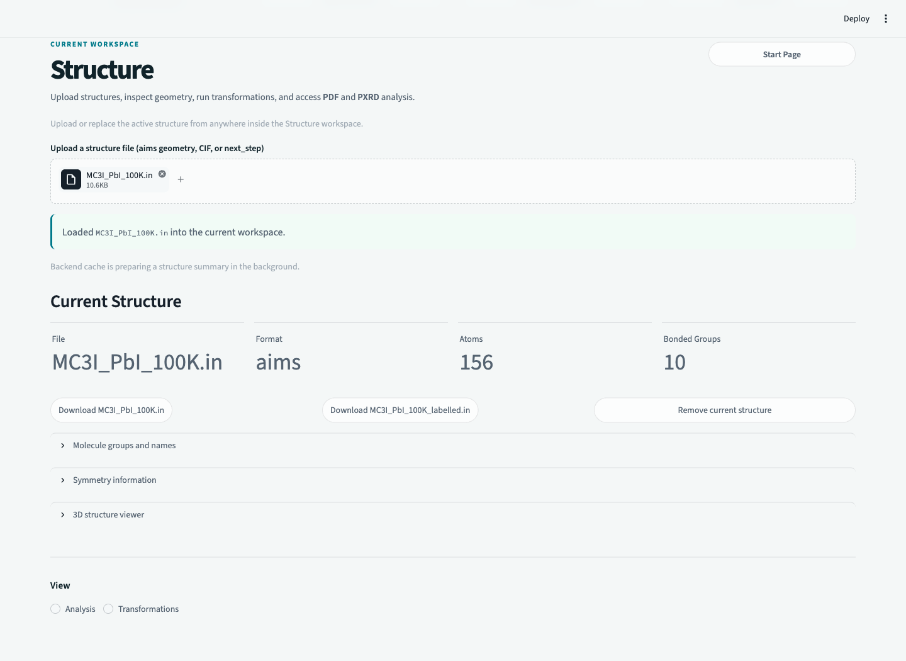

# Hybrid Perovskite Studio

Hybrid Perovskite Studio (HPS) is a local application for inspecting and transforming
crystal structures, plotting electronic-structure outputs, and analyzing molecular
dynamics trajectories. It focuses on hybrid perovskites and also supports other
organic and inorganic materials.

- **Structure:** symmetry, bonded-group inspection, molecular transformations, CIF/AIMS exports, PXRD, and optional PDF analysis.
- **Electronic:** FHI-aims bands with SOC/no-SOC comparison, Excel band-data exports, PDOS, spin texture, polarization, and absorption plots.
- **Dynamics:** AIMS MD output parsing, trajectory summaries, and structural analyses.
- **Utilities:** general plotting, mathematical column transformations, and a browser-based Python workspace.

[Documentation](https://rayanc72.github.io/hybrid-perovskite-studio/) ·
[Getting started](docs/user-guide/getting-started.md) ·
[Tutorials and example downloads](https://rayanc72.github.io/hybrid-perovskite-studio/user-guide/guided-examples/) ·
[Scientific scope](docs/reference/known-limitations.md)



## Install and launch

**Python 3.11 or newer and Git are required.** Python 3.11 is used by the release checks.
The current GitHub application release is **v0.3.0**; PyPI provides **v0.2.1**.
These instructions install the GitHub release with the application dependencies.

On macOS or Linux:

```bash
python3.11 -m venv .venv
source .venv/bin/activate
python -m pip install --upgrade pip
python -m pip install "hybrid-perovskite-studio[full] @ git+https://github.com/rayanc72/hybrid-perovskite-studio.git@v0.3.0"
hps
```

On Windows PowerShell, create the environment with `py -3.11 -m venv .venv`, activate
it with `.venv\Scripts\Activate.ps1`, then run the same installation and `hps` commands.
See [Getting started](docs/user-guide/getting-started.md) for activation alternatives,
optional DiffPy PDF dependencies, version checks, and the older PyPI installation.

## Get a first result

1. Download the [Structure example](https://rayanc72.github.io/hybrid-perovskite-studio/downloads/hps-example-structure.zip) and extract it.
2. Launch `hps`, open **Structure**, and upload `data/structure/MC3I_PbI_100K.in`.
3. Check **Current Structure**: 156 atoms and formula `C32H88I24N8Pb4`.
4. Follow the [structure inspection and rotation tutorial](docs/tutorials/structure.md) to inspect bonded groups and export a transformed CIF.

Additional walkthroughs cover [bands and Excel exports](docs/tutorials/bands.md) and
[trajectory analysis](docs/tutorials/dynamics.md). Each downloadable bundle includes
readable instructions, expected results, provenance, and checksum-validated inputs.
The `hps-examples` command can also build bundles locally; see the
[version notes](docs/user-guide/guided-examples.md#bundle-versions).

## Help and contributions

- [Troubleshooting](docs/user-guide/troubleshooting.md)
- [Workspace guides and screenshots](docs/user-guide/navigation-and-workspaces.md)
- [Input formats and scientific conventions](docs/reference/input-formats.md)
- [Contributing and development setup](CONTRIBUTING.md)
- [Public release procedure](RELEASING.md)
- [Report a bug](https://github.com/rayanc72/hybrid-perovskite-studio/issues)

HPS is research software; check assumptions and numerical results before publication.
See [validation and data attribution](docs/reference/scientific-validation.md),
[CITATION.cff](CITATION.cff), and the [Apache-2.0 license](LICENSE).

## Build the documentation

From a source checkout:

```bash
python -m pip install -r requirements-docs.txt
python scripts/build_doc_examples.py
python -m mkdocs serve
```

Use `python -m mkdocs build --strict` for a static build. GitHub Actions builds and
publishes the documentation from `main` to GitHub Pages; no additional branch is used.
