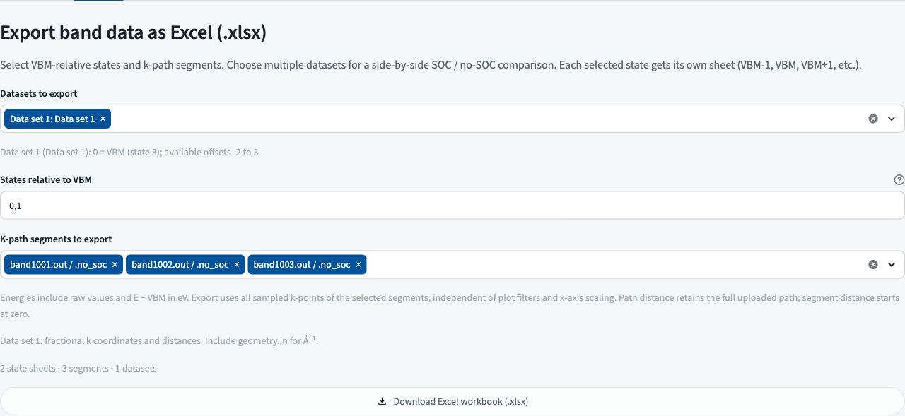

# Band Structure Studio

## Overview

- `Band Structure Studio` lives in the `Electronic` workspace.
- It combines three related outputs:
  - `Band Structure`
  - `Excel export`
  - `Brillouin Zone`
- It supports single-dataset and multi-dataset workflows.
- It is designed for uploaded FHI-aims output files.

## Where It Appears

- Workspace: `Electronic`
- View: `Bands and Spin`
- Tool: `Plot bandstructure`

Start with the [bands and Excel tutorial](../tutorials/bands.md) for a complete example.

## Core Purpose

- Plot one or more band structures.
- Align band energies relative to the detected VBM.
- Compare multiple datasets in one figure.
- Restrict the plot to selected k-path segments.
- Visualize the Brillouin zone from the uploaded lattice.
- Overlay the uploaded band path on the Brillouin-zone view.

## Required Files

- For band structure plotting:
  - `band####.out` or `band####.out.no_soc` (without SOC), for example `band1001.out.no_soc`
  - Both formats contain a k-point index, three k-point coordinates, then occupation/energy pairs.
  - No-SOC files are read directly; renaming them is unnecessary.
- For Brillouin-zone plotting:
  - `geometry.in`
- For x-axis path labels and k-path reconstruction:
  - `control.in`

## Inputs

- Number of datasets:
  - integer
  - allowed range in UI: `1` to `10`
- Per dataset:
  - one multi-file uploader
  - color text input
  - legend label text input

## Per-Dataset Upload Behavior

- Each dataset is uploaded independently.
- Each dataset gets its own widget key.
- This avoids duplicate Streamlit widget-key errors.
- The uploader accepts multiple files at once.
- A dataset containing only `.out.no_soc` band files is recognized automatically.
- If both filename types are uploaded, a selector chooses which type to plot for that dataset.
- To overlay SOC and no-SOC results, use two datasets with distinct colors and legend labels.
  Each dataset is aligned to its own VBM; their numbers of bands may differ.
- The standard `.out` suffix alone does not establish whether a calculation used SOC.
- The module looks for:
  - `band*.out`
  - `band*.out.no_soc`
  - `geometry.in`
  - `control.in`

## Automatic Dataset Summary

- Uploaded datasets are summarized in the `Loaded Data Sets` expander.
- Each summary card includes:
  - legend label
  - selected color
  - number of detected band files of the selected type (`.out` or `.out.no_soc`)
  - whether `geometry.in` was found
  - whether `control.in` was found
  - VBM state
  - VBM k-point coordinate
  - VBM energy
  - CBM state
  - CBM k-point coordinate
  - CBM energy
  - band gap

## Band-Edge Detection

- The module scans the uploaded `band*.out` files for each dataset.
- For a no-SOC dataset, the same scan uses its selected `band*.out.no_soc` files.
- It computes:
  - VBM information
  - CBM information
- The detected VBM energy is used as the dataset energy shift.
- This makes the plotted VBM align to `0 eV`.

## Band Structure Tab

- Main purpose:
  - generate the bandstructure figure
- Main controls:
  - energy-axis range slider
  - `Generate Band Structure` button
- Advanced controls:
  - k-path segment selection
  - x-axis label offsets
  - optional x-axis scaling to match the first dataset

## Band Structure Plot Features

- Supports one dataset or multiple datasets.
- Uses the selected dataset colors.
- Uses the selected legend labels.
- Draws vertical path-divider lines.
- Draws a horizontal reference line at `0 eV`.
- Shows a legend automatically when more than one dataset is plotted.
- Keeps the legend inside the plot area.
- Uses a white legend background and smaller text.

## Multi-Dataset Comparison

- Multiple datasets can be plotted together.
- Each dataset can have:
  - its own color
  - its own legend label
- Optional scaling can match the x-axis length to the first dataset.
- When scaling is enabled:
  - later datasets are rescaled to the first dataset’s total k-path length
- When scaling is disabled:
  - each dataset keeps its own native path length

## K-Path Segment Filtering

- The user can optionally restrict the plotted path.
- Input format:
  - one-based indices
  - comma-separated values
  - ranges allowed
- Example:
  - `1,3,5-6`
- Blank input means:
  - plot all segments
- Validation behavior:
  - negative or zero indices are rejected
  - descending ranges are rejected
  - non-existent segments raise a user-visible error

## X-Axis Label Offsets

- The user can optionally offset selected k-point labels.
- Purpose:
  - reduce label crowding
  - improve readability for dense paths
- Input format:
  - `label_index:offset`
  - comma-separated list
- Example:
  - `2:-0.08, 5:-0.15`
- Behavior:
  - works on selected x-axis labels only
  - applies in scaled and unscaled workflows

## Export For Band Structure

- Export section appears below a generated plot.
- Buttons are shown side by side.
- Available exports:
  - `PNG`
  - `PDF`
- The PDF export is suitable for later editing in vector-friendly tools.

### Momentum–energy Excel export

- Open the **Excel export** tab beside **Band Structure**. The tab is always visible;
  upload band files above to enable the export controls. Generating a plot is not required.
- Choose one or more datasets, then enter state offsets relative to each dataset's detected VBM:
  `0` is the VBM state, `-1` is the preceding state, and `+1` is the next state.
  Use comma-separated offsets (`-1,0,1`) or inclusive colon ranges (`-2:3`).
  States refer to individual file columns, including degenerate states.
- Select one or more k-path segments; the selector shows their source filenames.
- Download an `.xlsx` workbook with one sheet per selected relative state, named `VBM-1`,
  `VBM`, `VBM+1`, etc. Sheets have frozen headers and column filters.
- With one dataset selected, each sheet contains that state at every selected k-point, with
  dataset/file identifiers, original one-based state and segment numbers, the VBM offset,
  occupation, fractional k coordinates, raw energy, and energy relative to the dataset VBM in eV.
- With multiple datasets selected, each state sheet uses side-by-side column groups for every
  dataset. This supports SOC/no-SOC comparisons with
  different absolute state numbers and band counts. Column prefixes include the dataset index
  and legend label, so identical legend labels remain distinguishable.
- Comparison rows align by the four-digit band-file identifier and exact fractional k coordinates.
  Repeated coordinates match by occurrence within a segment. Different sampling grids are
  retained with blanks for unmatched values; no interpolation is performed. Rows follow the first
  dataset's sampling order, followed by points unique to later datasets. Each dataset retains
  its own path distances and units, including when their lattices differ.
- With `geometry.in`, the workbook also includes Cartesian k components in Å⁻¹. Path and segment
  distances then use Å⁻¹; otherwise they use fractional-coordinate distances. The
  `momentum_units` column records this distinction.
- `segment_distance` starts at zero for each segment. `path_distance` retains the cumulative
  distance along the full uploaded path, including omitted segments, without adding a jump
  between disconnected segments.
- Workbook selections are independent of the plot's segment filter, energy window, and x-axis
  comparison scaling. Energies always use the VBM of the full dataset as their reference.
- Empty or out-of-range selections display an error and remove the download button.

## Brillouin Zone Tab

- Main purpose:
  - plot the Brillouin zone for one selected dataset
- Main controls:
  - dataset selector
  - `Generate Brillouin Zone` button
- Dataset selection is useful when multiple datasets are uploaded.

## Brillouin Zone Construction

- The Brillouin zone is built from `geometry.in`.
- The reciprocal lattice is computed from the uploaded lattice vectors.
- The first Brillouin zone is constructed by Voronoi analysis in reciprocal space.

## Brillouin Zone Plot Features

- The plot is interactive.
- It uses Plotly 3D rendering.
- The user can:
  - rotate
  - zoom
  - pan
- It shows:
  - Brillouin-zone edges
  - reciprocal lattice vectors
  - reciprocal-vector labels
- If `control.in` is available, it also shows:
  - uploaded k-path segments
  - k-point labels

## Brillouin Zone Styling

- Background grid planes are hidden.
- Scene grids are disabled.
- The figure is enlarged for readability.
- Title and axis text are larger than the default.
- K-point and reciprocal-vector labels use larger text.
- The goal is a cleaner, more focused reciprocal-space view.

## Export For Brillouin Zone

- Export section appears below a generated Brillouin-zone plot.
- Buttons are shown side by side.
- Available exports:
  - `PNG`
  - `PDF`

## Reset Behavior

- `Clear files` resets the bandstructure upload widgets.
- This increments the uploader generation key.
- It forces Streamlit to treat future uploads as a new session of upload controls.

## Error Handling

- Invalid k-path segment input shows a user-facing error.
- Invalid label-offset input shows a user-facing error.
- Missing `geometry.in` blocks Brillouin-zone generation.
- Missing `control.in` prevents path-label reconstruction.
- Without `control.in`, the plot uses k-point coordinates from the band files as endpoint labels.
- Without `geometry.in`, path lengths use fractional-coordinate distances; upload the geometry
  for reciprocal-space distances.
- Missing both `band####.out` and `band####.out.no_soc` prevents band plotting.
- Mixing both filename types in a single backend dataset is rejected; the UI selects one type
  before submitting the dataset.

## Typical Workflow

- Open `Electronic`.
- Choose `Bands and Spin`.
- Choose `Plot bandstructure`.
- Set the number of datasets.
- Upload files for each dataset.
- Optionally inspect `Loaded Data Sets`.
- Open `Band Structure`:
  - set plot range
  - optionally edit advanced settings
  - generate the plot
  - export as `PNG` or `PDF`
- Open `Excel export`:
  - select datasets, VBM-relative state offsets, and segments
  - download the momentum–energy `.xlsx` workbook
- Open `Brillouin Zone` (requires `geometry.in`):
  - select a dataset
  - generate the plot
  - export as `PNG` or `PDF`

## Last Verified

- Application baseline: [GitHub v0.3.0](https://github.com/rayanc72/hybrid-perovskite-studio/releases/tag/v0.3.0)
- Documentation reviewed: 2026-11-22
