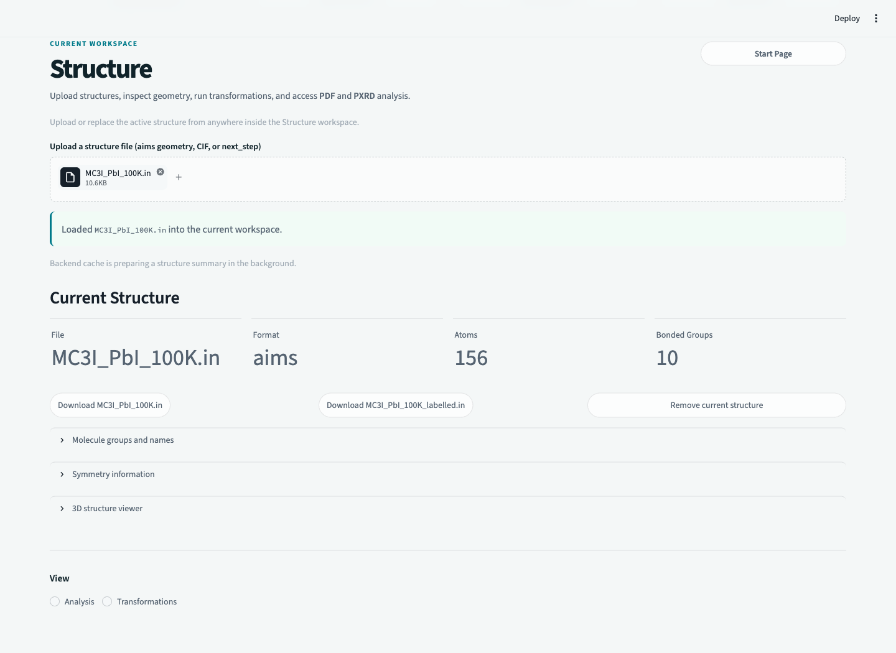

# Hybrid Perovskite Studio

Inspect crystal structures, transform finite molecular groups, visualize electronic
outputs, and analyze trajectories in a local workspace-based application.

!!! note "Documentation version"
    These guides describe the **GitHub v0.3.0 application**. Documentation and example
    packaging fixes follow public `main`. **PyPI v0.2.1** has fewer features; install
    the GitHub release to follow the v0.3.0 workflows.

## Start with a result

1. [Install and launch HPS](user-guide/getting-started.md).
2. [Download a guided example](user-guide/guided-examples.md).
3. Complete a tutorial:
    - [Inspect a structure, rotate a molecule, and export a CIF](tutorials/structure.md).
    - [Plot bands and export momentum–energy data to Excel](tutorials/bands.md).
    - [Validate a trajectory and download its metrics](tutorials/dynamics.md).

The upload and **Current Structure** summary remain available above the Structure
workspace's analysis and transformation controls.

## Find a tool

| Workspace | Typical tasks |
| --- | --- |
| [Structure](features/structure-workspace.md) | Inspect symmetry and bonded groups; rotate, translate, label, and export structures; simulate PXRD/PDF |
| [Electronic](features/electronic-workspace.md) | Plot bands, PDOS, spin texture, polarization, and absorption |
| [Band Structure Studio](features/band-structure-studio.md) | Compare SOC/no-SOC datasets, export Excel workbooks, and inspect reciprocal space |
| [Dynamics](features/dynamics-workspace.md) | Parse AIMS MD outputs and analyze frame archives |
| [Utilities](features/utilities-workspace.md) | Plot tables, transform columns, and use JupyterLite |

See [navigation and screenshots](user-guide/navigation-and-workspaces.md) for the
workspace map. For file requirements and interpretation, use the
[input and scientific reference](reference/input-formats.md),
[known limitations](reference/known-limitations.md), and
[troubleshooting guide](user-guide/troubleshooting.md).

## Scientific and project context

- [Scientific fixture validation and data citations](reference/scientific-validation.md)
- [About HPS](about.md)
- [Changelog](changelog.md)
- [Developer guide](developer/index.md)
