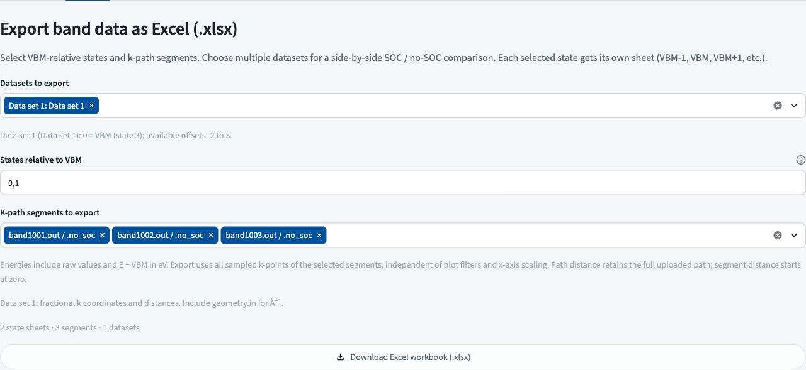

# Plot bands and export momentum–energy data to Excel

**Goal:** plot the compact reference bands and export selected states. Download and
extract the [Electronic bundle](../downloads/hps-example-electronic.zip).

## Plot the reference bands

1. Open **Electronic → Bands and Spin → Plot bandstructure**.
2. Use one dataset and upload all three files in `data/bands/` together.
3. Give the dataset a useful legend label, then expand **Loaded Data Sets**.
4. Inspect the detected band edges. These compact files retain **six states**;
   their state numbers differ from those in the original full calculation.
   The per-segment gaps in `expected_results.json` are **1.37794**, **1.53579**,
   and **1.53065 eV**. They are segment-specific references, not three separate
   measurements of a single global gap.
5. Open **Band Structure**, choose an energy window that includes the band edges,
   and click **Generate Band Structure**. The dataset VBM is shifted to **0 eV**.
6. Download a **PNG** or **PDF** from below the plot.

The fixture does not include `geometry.in` or `control.in`. Coordinate-based endpoint
labels and fractional path distances are expected; Brillouin-zone generation requires
a lattice from the same calculation.

## Export selected states

1. Open **Excel export**. Plot generation is not required for this tab.
2. Select the dataset and enter offsets `-1,0,1`: the state before the VBM, the VBM
   state itself, and the next state. These are state-column offsets, not energy values.
3. Select the desired segments and download the `.xlsx` workbook.
4. Inspect sheets **VBM-1**, **VBM**, and **VBM+1**. Compare raw energies against
   energies relative to the detected dataset VBM. Use the `momentum_units` column
   to interpret path distances.

Workbook selections are independent of the plot's energy window and segment filter.
The fixture lacks a geometry, so it does not provide Cartesian k coordinates in Å⁻¹.

## Compare your own SOC and no-SOC calculations

The bundle provides one reference dataset, not a matched SOC/no-SOC pair. For your own pair:

1. Increase the dataset count to two.
2. Upload SOC files into one dataset and `band####.out.no_soc` files into the other.
   Keep the no-SOC filenames unchanged. Add each calculation's own `geometry.in`
   and `control.in` when available.
3. Set distinct labels and colors. If one uploader contains both band filename types,
   select the intended type for that dataset.
4. Generate the comparison plot, or select both datasets in **Excel export**.

Each dataset is aligned to **its own VBM**; this compares band shapes rather than
absolute energy alignment. A `.out` suffix alone does not establish that SOC was used.
In Excel, rows match by band-file identifier and exact fractional k coordinates;
different grids remain as unmatched rows with blanks. No interpolation is performed.

See [Band Structure Studio](../features/band-structure-studio.md) for path scaling,
units, full workbook semantics, reciprocal-space plotting, and invalid-selection help.
