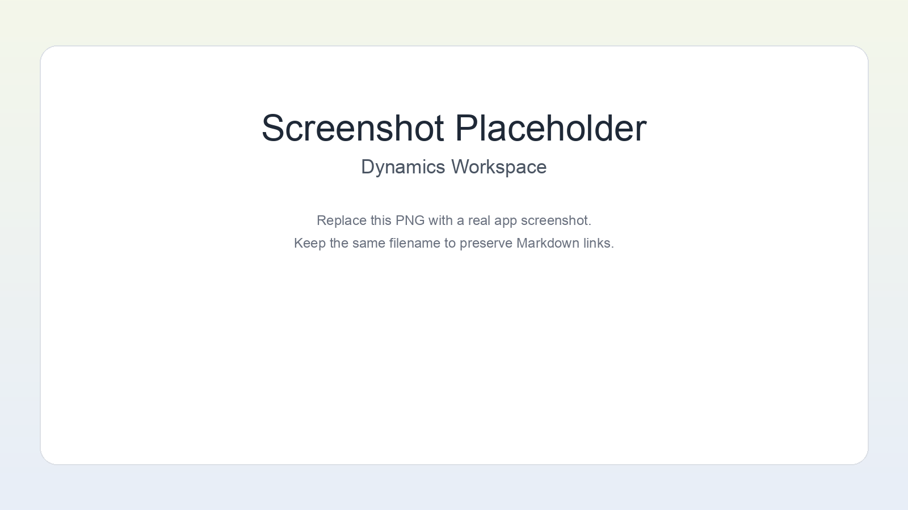

# Validate a trajectory and download its metrics

**Goal:** inspect a short reference trajectory and export its summary. Download and
extract the [Dynamics bundle](../downloads/hps-example-dynamics.zip).

## Upload the frame archive

1. Open **Dynamics → Trajectory analysis**.
2. Set **Enter timestep in fs (dt)** to **0.5**.
3. Upload the inner **`trajectory-frames.zip`** using **Upload zipped directory**.
   Do not upload the outer project bundle. If using an original v0.3.0 CLI bundle,
   zip only its `data/md/frames` directory first.
4. Allow backend validation to finish. If the page says validation is still running,
   rerun or refresh after a short wait.
5. Confirm **101 frames**, **62 atoms per frame**, and **0.05 ps** estimated duration.
6. Download the generated metrics CSV and first/last structure artifacts.



## Check the result

The example frames run from `geometry-005364.in` through `geometry-005464.in`.
The metrics should retain this order, a constant atom count, and the formula
`C12H32I8N4O4Pb2`. Frame zero is assigned time zero:

```text
time_ps = frame_index × timestep_fs / 1000
duration_ps = (frame_count − 1) × timestep_fs / 1000
            = 100 × 0.5 / 1000 = 0.05
```

The timestep is the interval **between saved frames**. If a simulation saved every
10th integration step, enter ten times the integration timestep.

## Continue to an analysis

The analysis selector offers distance, hydrogen-bond, average-structure, distortion,
pair-distribution, and anisotropic-displacement workflows. Choose atom selections,
cutoffs, and time ranges appropriate to your scientific question. Check units and
selection counts before interpreting a plot. The 50 fs sample is intended for a
workflow check and is too short for general long-time statistical conclusions.

The current downstream MDAnalysis path loads frames after the first into its
trajectory. Its analysis frame count and time origin can differ from the backend
metrics; inspect them before time-sensitive interpretation. The 101-frame and
0.05 ps checks above refer to the backend inventory.

## Prepare your own data

For the full interactive analysis path, use zero-padded **`geometry*.in`** FHI-aims
frames with consistent atom order and count. Files are sorted lexically, not by
modification time. Keep a single copy of each frame in the archive. The backend
inventory also accepts other structure suffixes, but that does not make them supported
by the downstream MDAnalysis path. See
[trajectory conventions and limits](../reference/input-formats.md#trajectory-archives).
