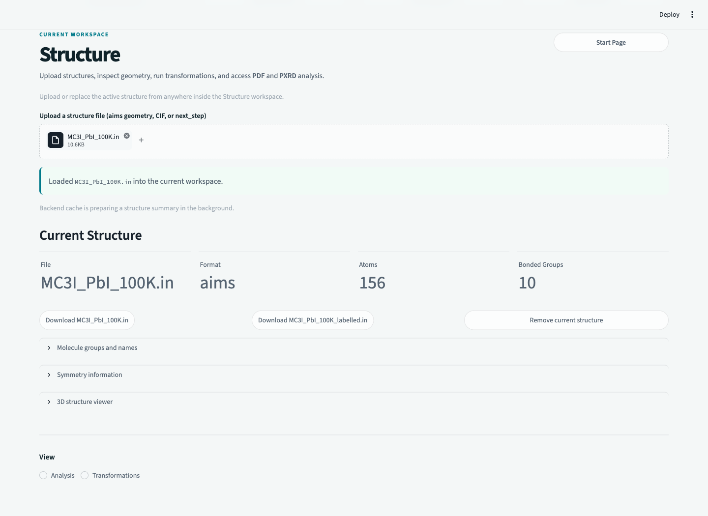

# Inspect a structure, rotate a molecule, and export a CIF

**Goal:** inspect the reference structure, rotate one finite group, and download the
result. Use the [Structure bundle](../downloads/hps-example-structure.zip) and the
[GitHub v0.3.0 installation](../user-guide/getting-started.md).

## Load and inspect

1. Extract the bundle and launch `hps`.
2. Open **Structure** and upload `data/structure/MC3I_PbI_100K.in`.
3. In **Current Structure**, confirm **156 atoms** and formula **C32H88I24N8Pb4**.
4. Expand the symmetry details and compare with **Aea2 (No. 41)**. Open
   **Analysis → Symmetry → Symmetrize structure** to explore symmetry tolerances.
   Different tolerances or a modified structure can change the detected group.
5. Expand **Molecule groups and names**. Identify a **finite molecule** and record its
   original group number. With the default detection settings, this example has
   **8 finite molecules and 2 periodic networks**. Periodic inorganic networks are bonded groups too; they
   cannot be rotated as finite molecules. Enable the optional viewer if useful.

Use the summary to inspect the uploaded file before selecting a view. There is no
separate **Overview** view.

## Rotate a finite group

1. Choose **Transformations → Molecule Operations → Rotation**.
2. Set **Select Rotation Type** to **Rotate Individual Molecules**.
3. Under **Select molecule indices**, select one of the finite group numbers noted above.
4. Enter crystal direction `0 0 1` and an angle of `10` degrees.
   This direction follows the third lattice vector; it is not necessarily Cartesian z.
5. Click **Set Parameters for Molecule N** for the selected group, then
   **Apply Multiple Rotations**. Set parameters for every selected molecule before applying.
6. Download the resulting AIMS geometry and use the CIF download control for the
   transformed structure. CIF generation occurs when the control is clicked.

The atom count and composition should remain unchanged. Rotation should preserve
internal distances within the selected group; it can change symmetry and contacts to
other groups. Check for unrealistic overlaps before using the geometry in a calculation.

## Verify the exported file

Upload the downloaded CIF as a new structure and check its atom count, formula, and
orientation. Keep the original download separately if you want to start again.
Symmetry after rotation need not remain Aea2. CIF labels may be made unique with atom
indices; format conversion can change textual formatting without changing the geometry.

If no group is available for rotation, inspect its finite/periodic classification and
the bonding criteria before changing cutoffs. See the
[Structure guide](../features/structure-workspace.md#notes-and-limitations) and
[input conventions](../reference/input-formats.md#structures-and-bonded-groups).
