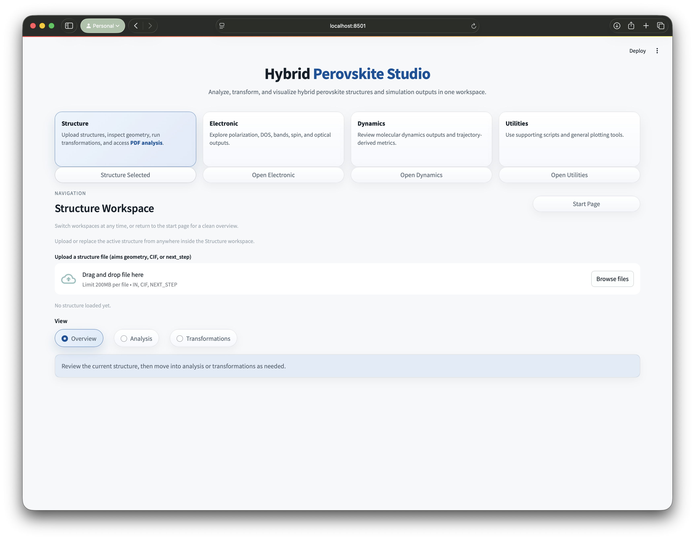
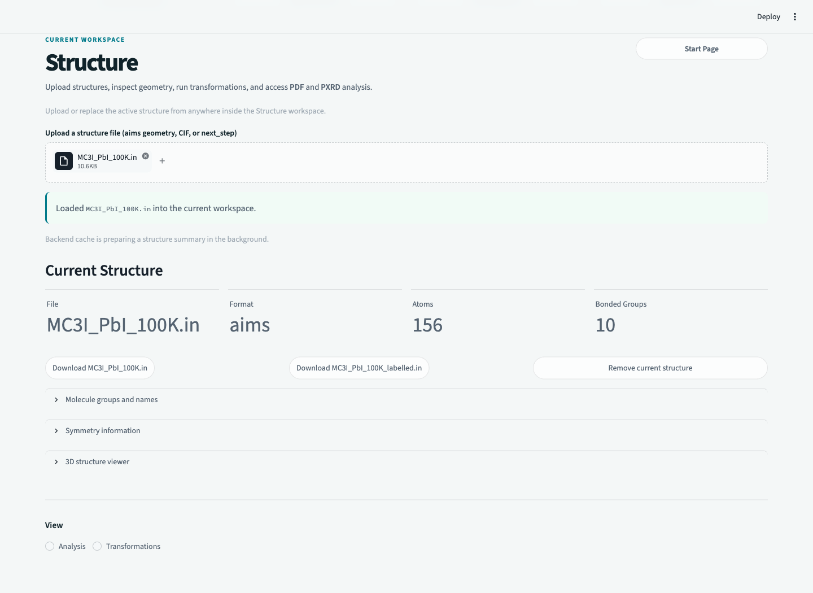
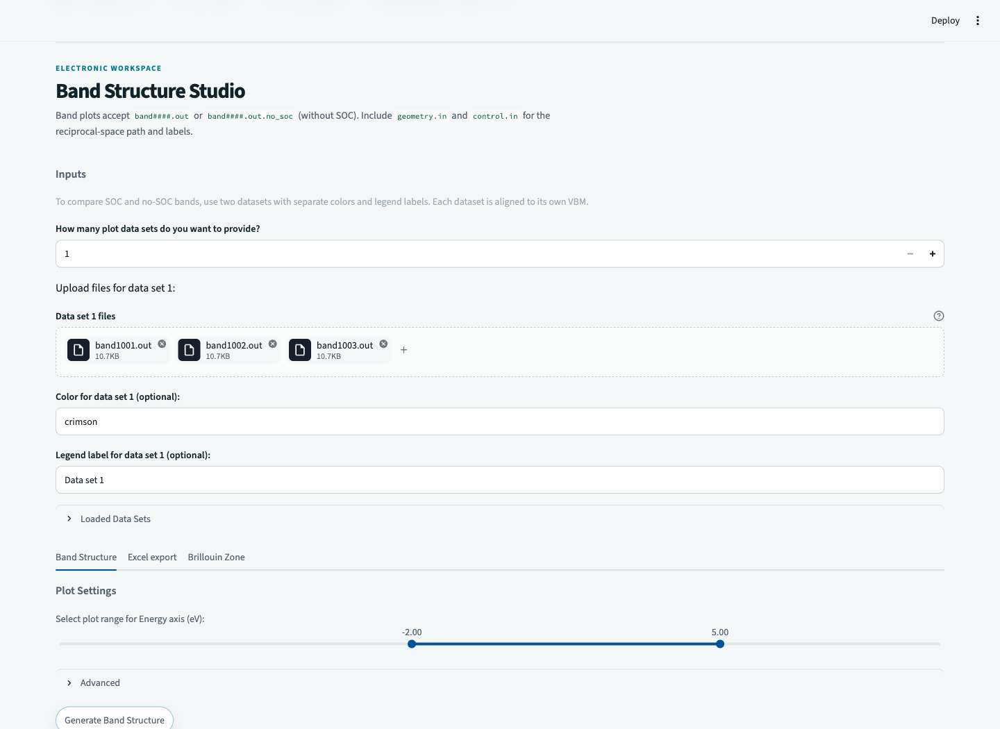
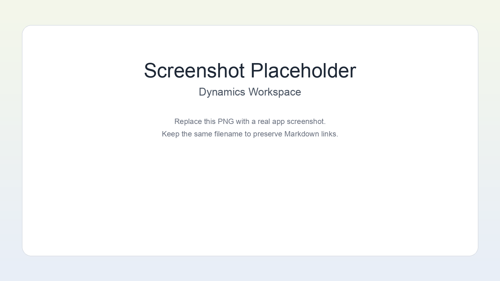
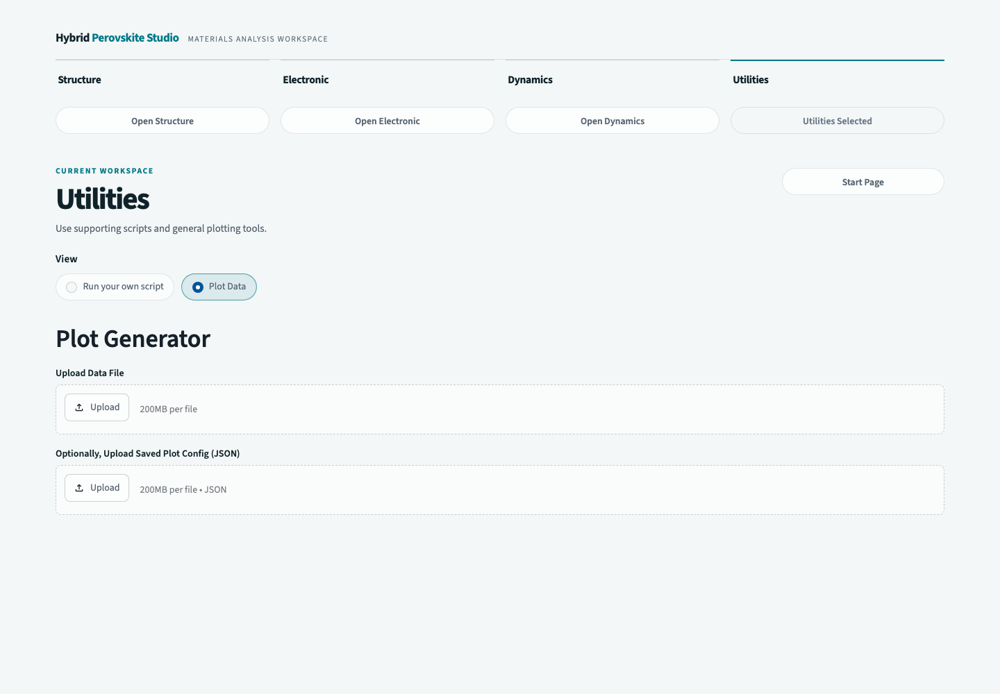
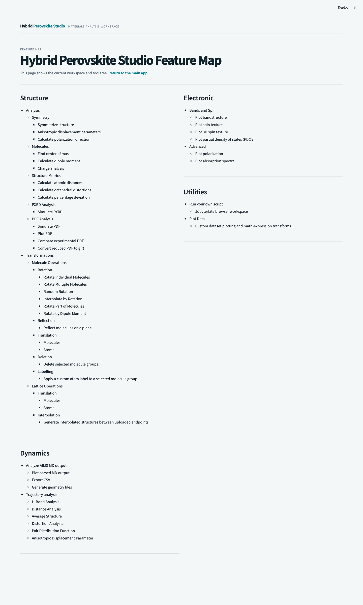

# Navigation And Workspaces

## Overview

The current UI is built around a landing page plus four workspaces:

- Structure
- Electronic
- Dynamics
- Utilities

Users start on the landing page, then choose one of the four workspace cards below the hero.

## Workspace Gallery

### Landing page

### Structure workspace

### Band Structure Studio

### Dynamics workspace

### Utilities workspace

### Feature map

## Landing Page

The landing page shows:

- a full-width introduction and perovskite-inspired hero graphic
- direct links to the workspace section and full feature map
- one card for each workspace

The dedicated feature-map page is generated from the same navigation registry that powers the visible workspace selectors.

## Workspace Selection

Each workspace card includes an `Open ...` link. Selecting it:

- activates that workspace
- records the workspace in the page URL
- switches the main page to the corresponding workspace

Users can return to the start page with the `Start Page` button.

## Feature Map

The `Explore every tool` link opens a dedicated page showing the app’s current capability tree. The page includes a link back to the main app.

Use the feature map to locate a tool, then follow its workspace guide for input and output requirements.

## Structure Workspace Pattern

The Structure workspace keeps the upload box and current structure summary above
two optional views:

- `Analysis`
- `Transformations`

Neither view is selected initially. Molecule-group names, finite/periodic
classification, symmetry information, and the structure viewer are available from
the summary without selecting a tool.

`Analysis` and `Transformations` each introduce a second selection level such as `Group` and then `Tool`.

The current `Structure -> Analysis` groups include:

- `Symmetry`
- `Molecules`
- `Structure Metrics`
- `PXRD Analysis`
- `PDF Analysis`

## Other Workspaces

- Electronic uses `View` plus `Tool`.
- Dynamics uses `View` to switch between direct MD output and trajectory analysis.
- Utilities uses `View` to select between script execution and generic plotting/data utilities.
